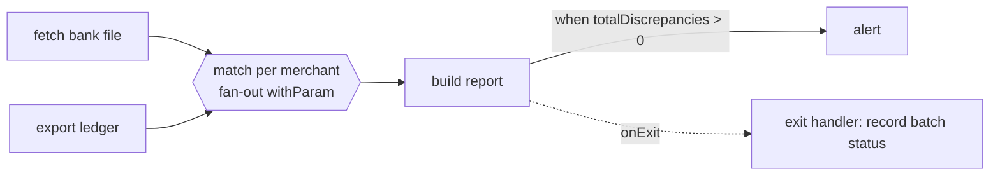

# Domain spec — card payment settlement & reconciliation

## The story in one paragraph
Merchants take card payments through **payment-api** all day. Every night the
acquiring bank drops a *settlement file* listing what it actually paid out. The
**settlement job** compares the bank's file with our own ledger, merchant by merchant,
and produces a settlement report plus a list of discrepancies (missing, duplicate or
amount-mismatched transactions). If there are discrepancies, someone is alerted.

Mental model: **payment-api is the cash register, the bank file is the bank statement,
the workflow is the accountant who ticks every line at night.**

## Bounded contexts
| Context     | Runs as                         | Argo tool that matters |
|-------------|---------------------------------|------------------------|
| Payments    | long-running service            | Argo CD, Argo Rollouts |
| Settlement  | batch, runs and exits           | Argo Workflows, Argo Events |

## Entities (keep it to these five)
| Entity            | Key fields                                                     | Owner      |
|-------------------|----------------------------------------------------------------|------------|
| `Merchant`        | id, name, settlementCurrency                                   | Payments   |
| `Payment`         | id, merchantId, amount, currency, status, createdAt            | Payments   |
| `AcquirerRecord`  | bankRef, merchantId, paymentId?, amount, valueDate             | Settlement (parsed from bank file) |
| `SettlementBatch` | id, businessDate, status, totals per merchant                  | Settlement |
| `Discrepancy`     | batchId, merchantId, type (MISSING, DUPLICATE, AMOUNT_MISMATCH), paymentId?, bankRef? | Settlement |

`Payment.status`: `AUTHORIZED → CAPTURED → REFUNDED` (or `DECLINED`).
Use Java records for `AcquirerRecord` and `Discrepancy`; JPA entities only in payment-api.

## payment-api (Spring Boot 4.1, Java 25)
| Endpoint                                  | Purpose |
|-------------------------------------------|---------|
| `POST /payments`                          | authorize → `AUTHORIZED` or `DECLINED` |
| `POST /payments/{id}/capture`             | capture |
| `POST /payments/{id}/refund`              | refund  |
| `GET  /payments?businessDate=YYYY-MM-DD`  | ledger export used by the settlement job (CSV) |
| `GET  /actuator/health/{liveness,readiness}` | Kubernetes probes |
| `GET  /actuator/prometheus`               | metrics, e.g. `payments_requests_total{outcome}` |

- PostgreSQL + Flyway; virtual threads on (`spring.threads.virtual.enabled=true`).
- **Fault injection for Rollouts practice:** env var `FAULT_RATE` (0.0–1.0) makes that
  share of requests return HTTP 500. Ship a "bad" version with `FAULT_RATE=0.3` and
  watch the canary analysis fail and roll back automatically.
- A tiny load generator (CronJob or `hey`) keeps traffic flowing so analysis has data.

## settlement-job (Spring Boot, non-web, one image)
One jar, the step is chosen by argument — each workflow step runs the same image:

| Step              | Input                                  | Output |
|-------------------|----------------------------------------|--------|
| `--step=fetch`    | bank file (input **artifact** from MinIO) | `records.json` artifact + **output parameter** `merchants` = JSON list of merchant ids |
| `--step=ledger`   | `businessDate` parameter, calls payment-api | `ledger.csv` artifact |
| `--step=match`    | `merchantId` parameter + both artifacts | `discrepancies-<id>.json` artifact, parameter `count` |
| `--step=report`   | all discrepancy artifacts              | `settlement-report.csv` artifact, parameter `totalDiscrepancies` |
| `--step=alert`    | `totalDiscrepancies`                   | log / webhook call |

Exit codes matter: `0` = success, non-zero = failed step (drives retries).
Make `ledger` occasionally fail (env `FLAKY=true`) to practise `retryStrategy`.

## The nightly workflow (DAG)

- `fetch` and `ledger` run **in parallel** (no dependency between them).
- `match` fans out with `withParam: "{{tasks.fetch.outputs.parameters.merchants}}"`.
- `alert` uses a `when` condition; an `onExit` handler runs whatever happens.
- `ledger` has `retryStrategy` (limit 3, backoff) because the API call can be flaky.

## How the workflow gets started
1. **Argo Events (primary):** MinIO `EventSource` watches bucket `acquirer-files`
   for `s3:ObjectCreated:*` → `Sensor` → trigger submits the workflow from the
   `WorkflowTemplate`, passing the object key as the `fileKey` parameter.
2. **CronWorkflow (fallback):** 02:30 Europe/Istanbul, uses yesterday's date.
3. **Manual:** `argo submit --from workflowtemplate/settlement -p businessDate=...`

## How payment-api gets released (Argo Rollouts)
Canary steps: `setWeight 20 → analysis (success rate ≥ 99% for 2m, Prometheus) →
setWeight 50 → pause 2m → 100`. Without a service mesh the weight is approximated by
replica count; add NGINX ingress traffic routing later for exact percentages.
Second exercise: switch the strategy to blue-green with a preview service and
`prePromotionAnalysis`.

## How everything is deployed (Argo CD)
- `gitops/bootstrap/root-app.yaml` → app-of-apps; it is the only thing applied by hand.
- Sync waves: platform (`-1`: MinIO, Prometheus, Argo Workflows/Events/Rollouts, Postgres)
  → apps (`0`: payment-api) → jobs (`1`: WorkflowTemplates, EventSources, Sensors).
- `ApplicationSet` with a list generator creates `payment-api-dev` and `payment-api-prod`
  (different namespaces and Helm values).
- `automated: { prune: true, selfHeal: true }` on dev; manual sync on prod.
- A `PostSync` hook Job runs a smoke test against payment-api.
- An `AppProject` restricts which repos and namespaces the apps may use.

## Out of scope (on purpose)
Real card schemes, PCI, ISO 8583, auth/OAuth, multi-currency FX, UI.
